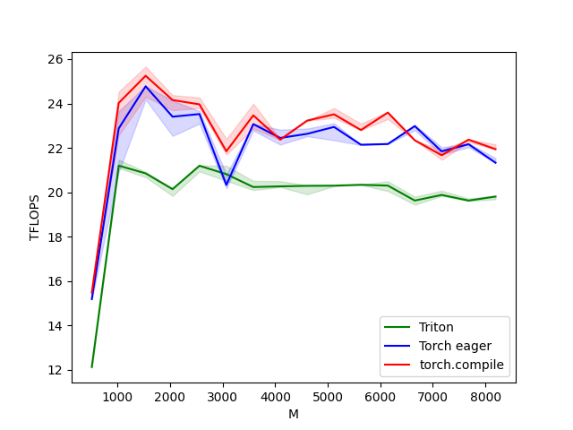
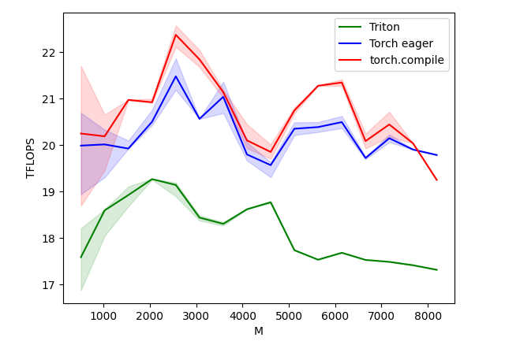

# Custom-SwiGLU-Kernel-And-Benchmark
A custom implementation of the SwiGLU feed-forward block with both the forward and backward pass. It has been validated for 16 different sizes against PyTorch and benchmarked against both the torch eager and compiled versions. The idea of grouped program ordering for L2 cache reuse and modulo wraparound trick is inspired by Triton's matmul tutorial (03-matrix-multiplication).

# Optimizations
- Fused Forward: The gate and up projections are computed in the same kernel, then SiLU(a) * b is computed in the epilogue, so the intermediate a and b tensors never need to be written to global memory.
- Fused Backward: da and db are the only gradients which directly use dh, so they are computed in the same kernel, meaning that the intermediate tensor $dh = dy @ W_d^T$ is never written to global memory.
- Lower Activation Memory: Only the inputs and weight gradients are saved from the forward pass, and a, b, h are recomputed on the backward pass, saving activation memory.
- Kernel Reuse: The same generic matmul kernel is used for both the down projection during the forward pass and $dW_d = h^T @ dy$ (the transposed h is handled by swapping its strides in the kernel call)
- Grouped program ordering increasing L2 cache use and the modulo wraparound trick for out-of-bound rows/columns not along the hidden dimension are inspired by Triton's matmul tutorial

# Kernels
| Kernel | Computes | Notes |
|---|---|---|
| fwd1_kernel |	$h = \text{SiLU}(x W_g) \odot (x W_u)$ | Has an optional WRITE_AB parameter to know if to store a, b (used in backward)
| matmul_kernel |	$y = h @ W_d, dW_d = h^T @ dy$ | Generic strided matmul
| bwd1_kernel	| $da = dh \odot b \odot s \odot (1+a(1-s)),$ $db= dh \odot a \odot s,$ and $dh = dy @ W_d^T$ | dh is not stored to global memory
| bwd3_kernel	| $dW_g = x^T @ da, dW_u = x^T @ db$ | Requires only 1 pass over x
| bwd4_kernel	| $dx = da @ W_g^T + db @ W_u^T$ | 

# Setup and Results
- GPU: Tesla T4 (Colab)
- Inputs and weights in fp16
- Validated and benchmarked on (M, N, K) = (512 * {1, 2, ..., 16}, 2048, 5504)

| | Triton / torch.compile (mean) | Triton / torch.eager (mean) |
|---|---|---|
| Forward | 0.87x | 0.90x |
| Backward | 0.88x | 0.90x |

Forward Pass: 

Backward Pass: 

